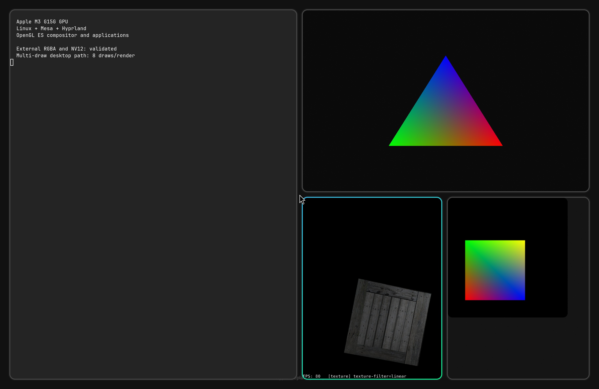

# Linux GPU rendering on the Apple M3 (G15)

> [!WARNING]
> **Early research release, one machine only.** It installs and runs on a
> MacBook Air 13" M3 (J613) whose Linux install uses the macOS 14.7 stub
> firmware, and nowhere else: the driver refuses to start on other models or
> firmware. It has been tested on one such laptop. A GPU hang the firmware does
> not report (for example an app's infinite-loop shader) needs a reboot, GL is
> at the 2.1 level (GLES 3.0), and there is no support. Do not use it on a
> machine you cannot afford to reboot.

A working GPU-accelerated Linux desktop on a MacBook Air M3 (J613, T8122,
GPU G15G, firmware 14.7): Hyprland and GL/GLES clients rendered by the M3 GPU
through Mesa, using a G15 port of the Asahi AGX kernel driver.

Video: [media/g15-hyprland-demo.mp4](media/g15-hyprland-demo.mp4) (36 s,
2560x1664: foot, weston-simple-egl, simple-dmabuf-egl and the glmark2 texture
scene, all on the G15 GPU).

## Status

| glmark2 scene, 1920x1080 window in Weston (median of 3 passes) | G15 | llvmpipe (CPU) |
|---|---|---|
| texture, nearest filtering | 477 fps | 327 fps |
| texture, linear filtering | 483 fps | 296 fps |
| effect2d, 3x3 kernel | 395 fps | 89 fps |
| effect2d, 5x5 kernel | 280 fps | 44 fps |
| pulsar | 469 fps | 227 fps |
| desktop, blur | 56 fps | 26 fps |
| desktop, shadow | 229 fps | 56 fps |
| **Score** | **343** | **151** |

Raw numbers: [media/g15-glmark-compare-20261018.csv](media/g15-glmark-compare-20261018.csv).
Mesh-heavy scenes are no longer slow: in the full offscreen glmark2 run at
2560x1664 the Gouraud-shaded mesh renders at 479 fps (2 fps in the previous
release) and the build scene at 537-548 fps.

The [native aquarium demo](tools/demo/README.md), a desktop GL 2.1 port of the
WebGL Aquarium, renders its 1440x1440 scene at 59, 38 and 18 fps with 1,000,
5,000 and 10,000 fish on the G15, against 16, 10 and 7 fps on llvmpipe.

Also: all 306 tests in our desktop-GL piglit list, a complete glmark2 run
(score 443; its terrain scene's compute stage is refused, as
expected), a one-hour Hyprland soak with 676,080 GPU jobs, and
1,000 fresh GL processes in a row, all with no GPU errors or
recoveries.

**Known limits.** A GPU hang the firmware does not report needs a reboot
(faults and the timeouts it reports recover). One GPU job runs at a time,
with a short wait after each render. Desktop GL is at the 2.1 level plus
extensions (GLES 3.0), with no MSAA or framebuffer compression. See
[docs/g15-spec/70-known-limits.md](docs/g15-spec/70-known-limits.md) for the
full list and what is known about each.

## Can I use it?

Only if all of these hold (details and the commands to check them:
[AGENTS.md](AGENTS.md), section 1):

- a **MacBook Air 13" M3** (model J613);
- it **already runs Linux** through an Asahi-style install (m1n1, U-Boot,
  GRUB);
- the Linux install's **stub macOS firmware is 14.7**
  (`/proc/device-tree/chosen/asahi,os-fw-version` reads `14.7`).

Other M3 machines, other M-series chips and other firmware versions are not
supported yet. The driver needs a set of machine- and firmware-specific values
(render profile, firmware tables, device-tree overlay) that so far exist only
for this configuration; see [kernel/README.md](kernel/README.md).

## Installing

Clone this repository on the laptop and have a coding agent (Claude Code,
Codex or similar) follow [AGENTS.md](AGENTS.md); it is also readable as a
manual guide. It checks the machine, builds the kernel and Mesa from source,
adds the kernel as a **one-time, non-default** boot entry next to your
existing one, loads the driver and runs a rendering test. Your existing boot
entry, m1n1, macOS and disk encryption are left alone, and undoing it is
removing a few files. Building takes a while (a full kernel plus Mesa, on
the laptop).

## What is here

| Path | Contents |
|---|---|
| [AGENTS.md](AGENTS.md) | Install guide, written for a coding agent |
| [kernel/](kernel/README.md) | The kernel: base patches, the G15 driver patch, config, build script, driver loader |
| [docs/g15-spec/](docs/g15-spec/README.md) | How the G15 GPU is driven: memory map, firmware interface and submission, render and compute jobs, shaders, display, known limits. Written for developers who know the M1/M2 (G13/G14) Asahi driver |
| [mesa/](mesa/README.md) | The Mesa G15 render patch, one diff against Gravity Mesa `87ac51d` |
| [tools/gl-test/](tools/gl-test/README.md) | GLES test client with CPU-oracle and llvmpipe checks |
| [tools/desktop/](tools/desktop/README.md) | Example scripts for running a Hyprland session on the G15 GPU |
| [tools/demo/](tools/demo/README.md) | The WebGL Aquarium ported to a native OpenGL 2.1 program, run the same way on macOS and on the G15 driver |
| [media/](media/) | Demo video, screenshot and numbers |

**Built-in values.** Some tables in the kernel driver hold numbers observed
on one J613 while macOS drove the GPU with the 14.7 firmware (a render
profile, firmware hardware and power words, init data, and device-tree
overlays generated from that machine). They are what makes it work without
any macOS step on that configuration, and the reason it works only there.
Each such file says so at the top.

## How this was made

This is an independent project, not affiliated with or endorsed by Asahi
Linux, and nothing here has been submitted to Asahi. It builds on the Asahi
Linux kernel driver and Mesa work for M1/M2 and on Gravity Mesa's Apple9
compiler. The G15 port, the reverse engineering and these documents were
produced largely by AI coding agents (Claude Code and Codex) working on real
hardware under the project owner's direction. No Apple code, firmware or raw
captures are included; the driver's built-in tables and the documents contain
values observed in captures of macOS on the test laptop.

## License

MIT (see [LICENSE](LICENSE)). The Mesa patch is a change to Mesa and is
under Mesa's MIT license. The native aquarium in
[tools/demo/aquarium-native/](tools/demo/aquarium-native/) ports the WebGL
Aquarium (Copyright 2009 Google Inc.) and is under its BSD 3-Clause license;
see [its NOTICE](tools/demo/aquarium-native/NOTICE).
